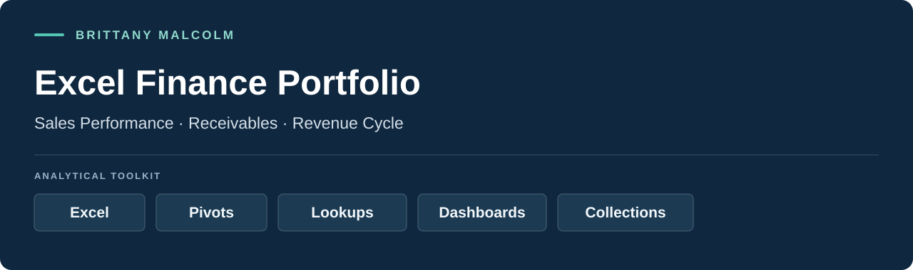
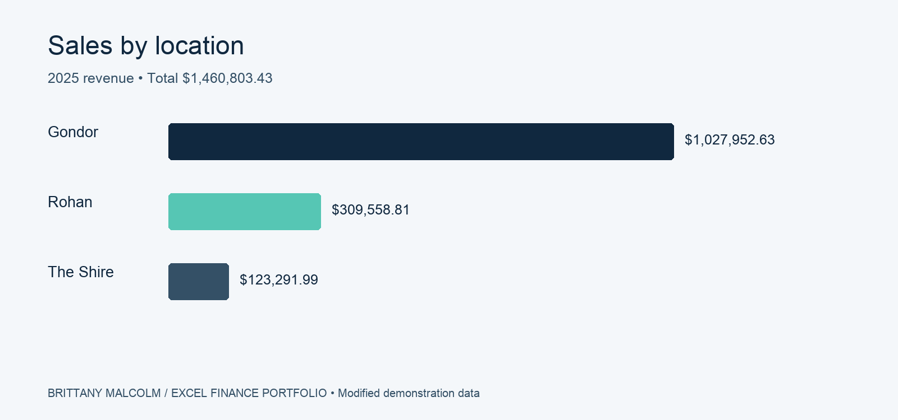
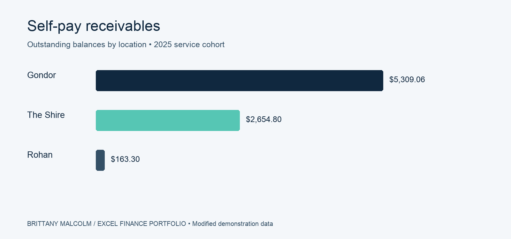

<p align="center"><a href="#featured-workbooks">Explore the workbooks</a> · <a href="#contact">Contact</a></p>

## Introduction

I built these Excel models to analyze sales, monitor receivables, and support insurance collections in an eye-care practice. The portfolio combines transaction-level analysis with dashboards and operational tracking.

Names, figures, and company details have been modified for demonstration. The Eye of Gandalf scenario provides a fictional setting for the work.

## Featured workbooks

| Workbook | Business question | Excel techniques |
|---|---|---|
| [Sales Analysis 2025](workbooks/Sales%20Analysis%202025.xlsx) | Which locations and services drive revenue? | Lookups, PivotTables, dashboard slicer |
| [Insurance Analysis 2025](workbooks/Insurance%20Analysis%202025.xlsx) | How do recovery and payment timing vary? | Calculated pivot fields, aging, payment timing |
| [Insurance Claim Tracker 2025](workbooks/Insurance%20Claim%20Tracker%202025.xlsx) | Which claims need follow-up? | Tables, outstanding balances, carrier tracking |
| [Self Pay Receivable Analysis 2025](workbooks/Self%20Pay%20Receivable%20Analysis%202025.xlsx) | Where do outstanding balances remain? | Aging, payment timing, dashboard slicer |
| [Self Pay Receivable Analysis 2023-2025](workbooks/Self%20Pay%20Receivable%20Analysis%202023-2025.xlsx) | How do collections compare across service cohorts? | Multi-year PivotTables, recovery analysis |
| [EOG Receivable Worksheet - GONDOR](workbooks/EOG%20Receivable%20Worksheet%20-%20GONDOR.xlsx) | What remains due after installments? | Structured references, installment ledger |

## Analysis previews

These images are generated from the workbook data and provide a quick view of selected results.





## Repository layout

```text
github-excel-portfolio/
├── README.md
├── images/
└── workbooks/
```

## Skills demonstrated

Excel modeling · sales analysis · receivables monitoring · lookup maintenance · PivotTables · dashboard reporting · payment reconciliation

## Contact

I welcome conversations about Financial Analyst opportunities focused on asset management, portfolio analysis, investment risk, and reporting.

- **GitHub:** [brjmalc](https://github.com/brjmalc)
- **LinkedIn:** [Brittany Malcolm](https://www.linkedin.com/in/brittanyjmalcolm/)
